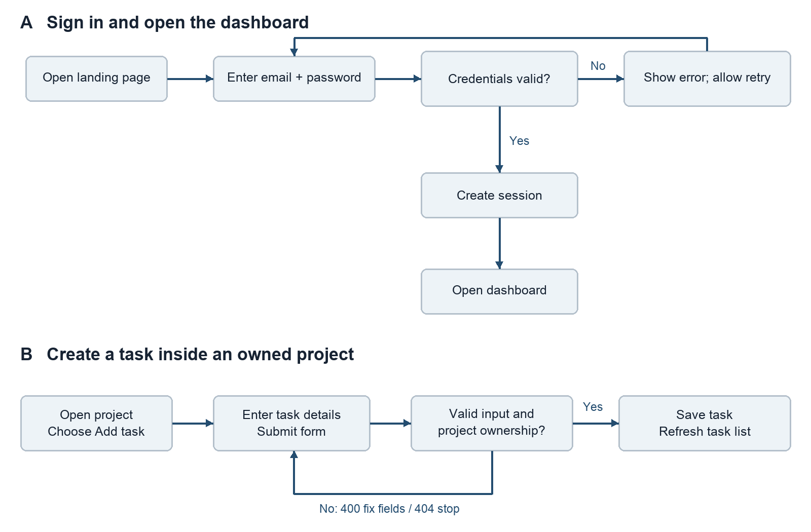
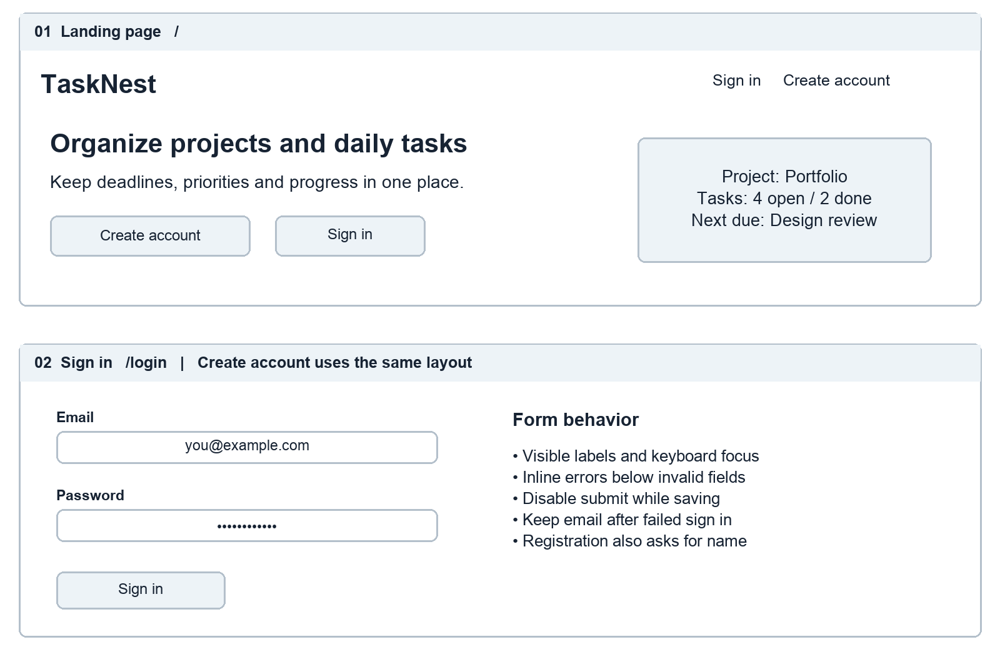
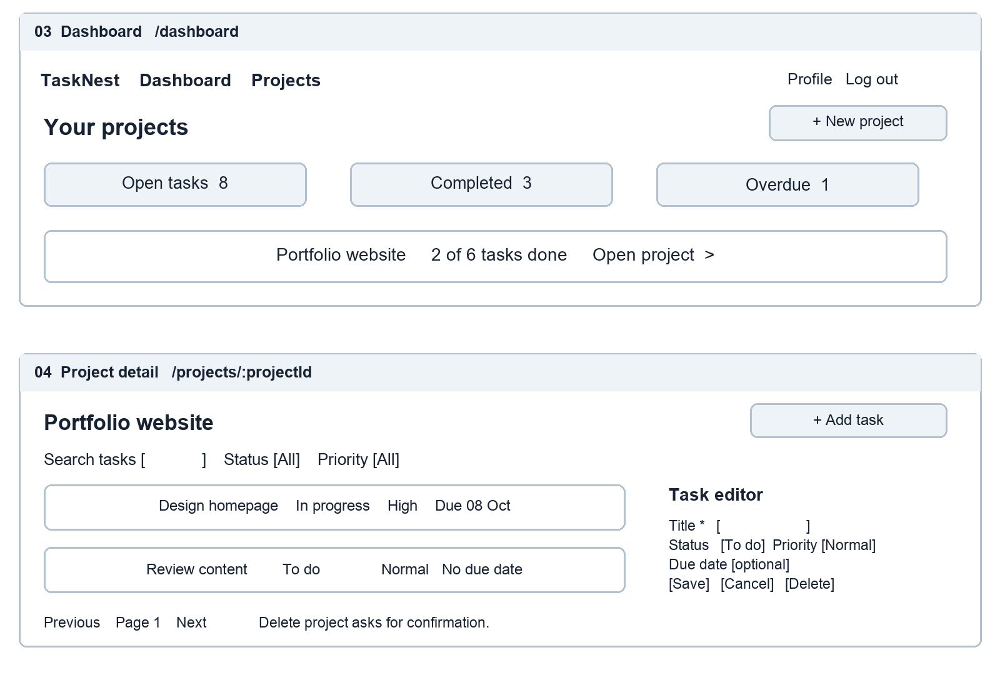
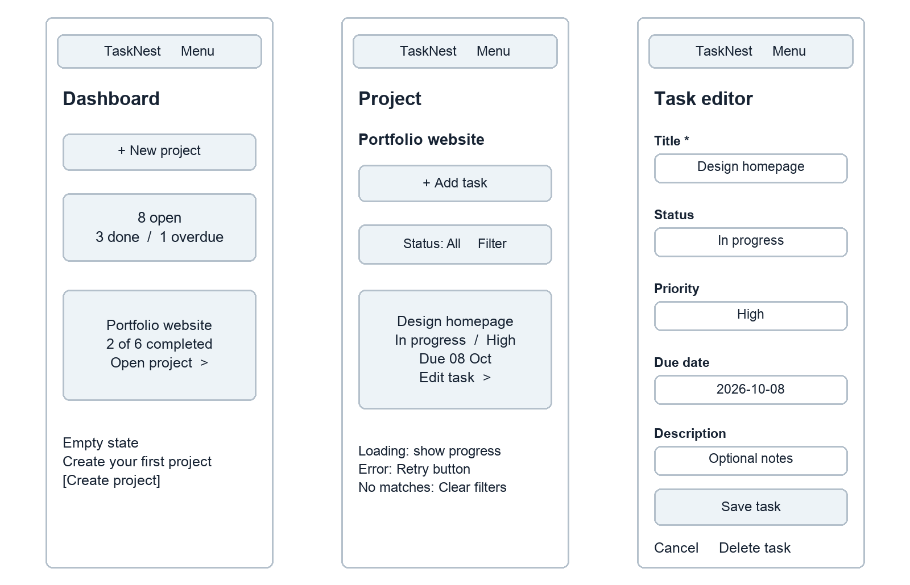
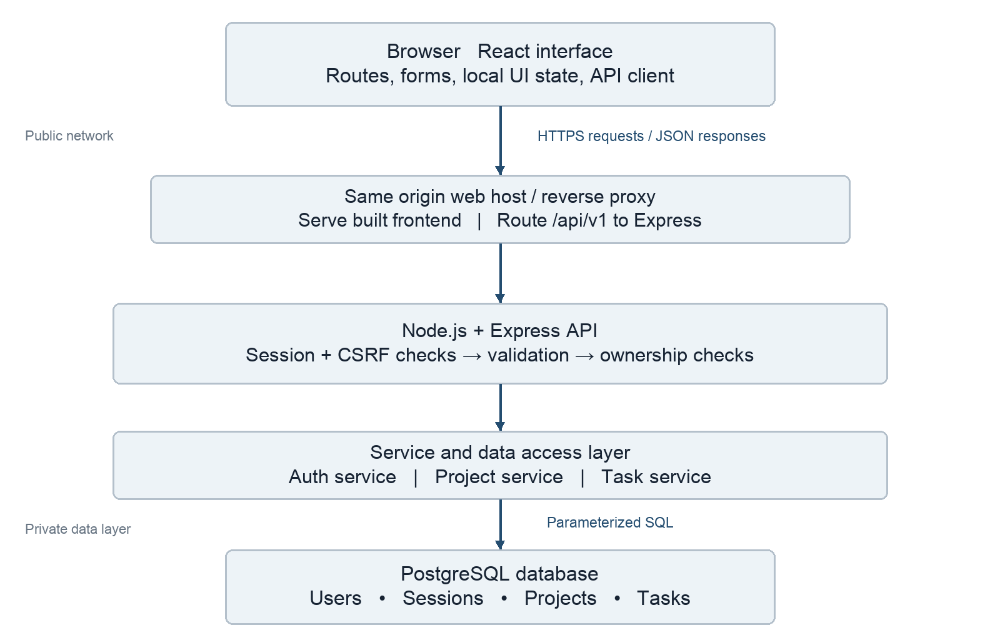
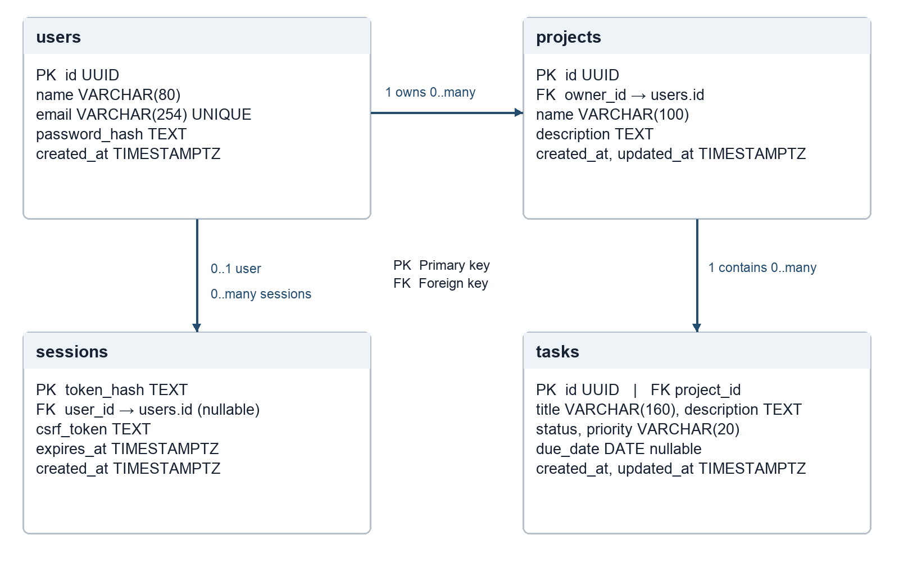

# TaskNest Week 1 Report

Yash  |  Junior Full Stack Developer Intern  |  YuvaIntern
30 September 2026

### Project brief

TaskNest is a proposed full stack web application for students and early career professionals who need to organize personal projects and track the tasks within them. It brings project notes, deadlines, priorities and completion status into one private workspace. The Week 1 outcome is a documented design that can guide implementation during the remaining internship weeks.

The core journey is simple: create an account, open the dashboard, create a project, add tasks and update their status. A user can maintain several projects, but every project belongs to one user. This keeps the initial scope practical for a six week internship while still covering authentication, persistent data and complete CRUD operations.

### Objectives and boundaries

The application will make outstanding work easy to find, preserve updates across sign ins, and prevent one user from reading or changing another user’s information. The minimum viable product includes registration, sign in, project management, task management, filtering and a progress summary.

Shared workspaces, payments, file uploads, email reminders, chat and AI features are outside the initial scope. The screens in this report are wireframes and use illustrative data. Application implementation, deployed services and runtime tests belong to later weeks.

### Required functions

| ID | Requirement | Acceptance condition |
| --- | --- | --- |
| F1 | Account and session | Register, sign in and sign out; private routes require a valid session. |
| F2 | Project management | Create, read, rename and delete owned projects; confirm deletion. |
| F3 | Task management | Add, view, edit and delete tasks inside an owned project. |
| F4 | Task discovery | Filter by status and priority; search titles; paginate task results. |
| F5 | Progress summary | Count open, completed and overdue tasks for the signed in user. |

## User journeys and interaction flows

The public landing page offers registration and sign in. Successful registration creates a user record and a session, then opens the dashboard. Returning users sign in with their credentials. Each private API request rechecks the session and resource ownership, independently of navigation controls in the interface.

### Alternative and destructive paths

An expired session returns 401 and sends the user to sign in again. Invalid fields return 400 with field messages. A missing or unowned project returns 404 without exposing another user’s data. A network failure preserves the unsaved form and offers Retry. A task appears as saved only after a successful server response.

Deleting a task requires confirmation. Deleting a project explicitly warns that its tasks will also be deleted; Cancel leaves all records untouched. Confirm triggers one database transaction. Successful deletion returns the user to the dashboard and refreshes the summary. Sign out invalidates the session and clears the session cookie.

## Entry screens and account forms

The landing page explains the purpose before asking the visitor to register. Sign in and registration share a narrow, readable form. Registration adds a name field; neither form asks for information unrelated to the application. The routes are /, /login and /register.

### Input and feedback rules

Use an email input, visible password label and optional Show password control. Registration accepts a name of 1–80 characters and a password of 12–128 characters; passwords are never trimmed or stored as plain text. Normalize email by trimming and lowercasing it. Show required field errors beside the relevant control and a generic message for invalid sign in credentials.

Every control needs a visible label and keyboard focus. A pending request changes the submit label to Signing in or Creating account and prevents duplicate submissions. Successful authentication uses a fixed dashboard destination to avoid accepting arbitrary redirect URLs.

## Dashboard and project workspace

The dashboard summarizes the user’s work and lists projects. Selecting a project opens its tasks. A project create or edit form asks for name and optional description. The task editor supports title, description, status, priority and an optional due date.

### Component and state plan

Planned React components include AppShell, ProjectCard, SummaryStats, TaskList, FilterBar, ProjectForm, TaskForm and ConfirmDialog. Page components fetch server data; forms own temporary field values. Filters and the page number are reflected in URL query parameters. Completed counts are derived from stored tasks rather than separately edited values.

A successful mutation refetches the affected list and summary. The first release uses confirmed server responses instead of optimistic updates to simplify recovery. Empty projects show Add your first task. A failed list request shows an explanation and Retry; it does not display a misleading zero count.

## Mobile behavior and accessibility

At narrow widths, the dashboard uses one column and each task becomes a card. The task editor opens as a full page so fields remain readable. At wider widths, summary panels can sit in a row and the task editor can use the side panel shown on the previous page.

### Responsive and accessibility acceptance targets

Verify the implemented interface at widths of 320, 390, 768 and 1440 pixels with no horizontal page scrolling. Use a logical heading order, semantic buttons, persistent field labels and visible keyboard focus. Status must appear in words as well as color. Interactive targets should be at least 44 by 44 CSS pixels.

Move focus into a confirmation dialog and return it to the originating control when the dialog closes. Announce save results and validation summaries to assistive technology. These are implementation targets; no browser or accessibility test results are claimed in Week 1.

## Technical architecture and request handling

The proposed stack is React for the interface, Node.js with Express for the API, and PostgreSQL for persistent records. A single origin serves the frontend and forwards /api/v1 requests to the API. The browser has no direct database access. Versions will be pinned when implementation begins.

### Server responsibilities

Routes map requests to controllers. Middleware applies request size limits, session checks, CSRF protection and validation. Services enforce ownership and coordinate operations. The data access layer uses parameterized SQL and transactions. One error handler translates known failures into consistent JSON responses and hides internal stack traces.

For task creation, the API resolves the session user, validates the body, checks that the referenced project belongs to that user, inserts the task and returns 201. A transaction protects the ownership check and insert from concurrent project deletion. Logs record a request identifier and status without passwords, session tokens or task descriptions.

## Database schema and relationships

The design uses four tables. Users own projects, projects contain tasks, and sessions connect authenticated requests to users. One parent can have zero or more children; each project and task must reference one existing parent. An authenticated session belongs to one user; anonymous sessions have no user until sign in. Task ownership is derived through the project rather than duplicated in a second owner field.

### Constraints and query rules

All identifiers use UUIDs except the hashed session token. Email is unique after normalization. Task status accepts todo, in_progress or done; priority accepts low, normal or high. Required names and titles cannot be blank. Descriptions are limited to 2,000 characters. Due dates are optional calendar dates; creation and update timestamps use UTC.

Foreign keys use cascading deletion from users to projects and sessions, and from projects to tasks. Account deletion is not exposed in the first release. Add indexes on projects(owner_id), tasks(project_id, status, due_date) and sessions(expires_at). Query tasks through a project constrained by the session user’s ID.

An overdue task has a due date earlier than the current UTC date and a status other than done. Dashboard counts use the same definition. Use deterministic sorting by created_at and id for paginated results. The accompanying schema.sql is a design reference; no database has been deployed.

## API contract and data validation

All routes below use the /api/v1 prefix and JSON. Private routes require a valid session cookie. Mutating routes also require the CSRF token returned by the session bootstrap route. Pagination uses page ≥ 1 and limit 1–100, with a default limit of 20.

| Method and path | Purpose and input | HTTP |
| --- | --- | --- |
| GET /auth/session | Bootstrap a CSRF token; return user or null. | 200 |
| POST /auth/register | name, email, password; establish session. | 201 |
| POST /auth/login | email, password; rotate session. | 200 |
| POST /auth/logout | Invalidate session and clear cookie. | 204 |
| GET /dashboard | Return owned project and task counts. | 200 |
| GET /projects | List owned projects; page and limit. | 200 |
| POST /projects | name and optional description. | 201 |
| GET /projects/:id | Read one owned project. | 200 |
| PATCH /projects/:id | Update name and/or description. | 200 |
| DELETE /projects/:id | Delete project and its tasks. | 204 |
| GET /projects/:id/tasks | Filter status, priority, q; page and limit. | 200 |
| POST /projects/:id/tasks | title; optional description, status, priority, dueDate. | 201 |
| GET /tasks/:id | Read task through owned project. | 200 |
| PATCH /tasks/:id | Update allowed task fields only. | 200 |
| DELETE /tasks/:id | Delete task through owned project. | 204 |

### Response conventions

Return resources as {"data": {...}} and lists as {"data": [...], "pagination": {"page": 1, "limit": 20, "total": 6}}. Create responses include the new identifier. Updates return the saved resource; 204 responses have no body. Never return password hashes, session token hashes or another user’s records.

Errors use {"error": {"code": "VALIDATION_ERROR", "message": "Check the highlighted fields", "fields": {"title": "Required"}}}. Use 400 for invalid input, 401 for missing authentication, 403 for CSRF failure, 404 for missing or unowned resources, 409 for duplicate email, 429 for rate limits and 500 for unexpected failures.

## Design rationale and quality requirements

| Decision | Reason | Tradeoff |
| --- | --- | --- |
| React components | Reuse form, list and navigation patterns across screens. | Requires deliberate state ownership and loading states. |
| Express modular monolith | Keep routing, services and persistence in one deployable API. | Independent service scaling is deferred. |
| PostgreSQL | Model clear ownership relationships and enforce constraints. | Schema changes need migrations. |
| Server stored sessions | Allow immediate sign out and server side invalidation. | Session lookup adds a database operation. |
| Same origin hosting | Keep cookies and frontend API routing straightforward. | Deployment must configure the /api proxy. |
| Private personal projects | Keep permission rules simple and implementation achievable. | Collaboration is excluded from the initial release. |

### Security design

Hash passwords with a maintained Argon2id library; do not implement cryptography manually. Use random opaque session tokens, store only their hashes, rotate on authentication and expire after seven days. The session bootstrap creates an anonymous session when needed, returns a CSRF token and never returns the session token. Registration and sign in require CSRF checks too.

Production cookies use Secure, HttpOnly, SameSite=Lax and Path=/. Use HTTPS, verify Origin on unsafe requests and compare the submitted CSRF token to the session value. Limit repeated authentication attempts by IP and account identifier. Validate allowed fields server side and exclude owner_id from client writable fields. Store configuration secrets outside Git.

### Performance and reliability targets

Paginate lists, select only needed fields and index ownership and filter columns. A later test target is a 95th percentile API response below 500 milliseconds with 20 concurrent test users and a seeded set of 1,000 tasks. This is a target, not a measured result. Define the test environment before measuring it.

Mutations use transactions when several records must change together. The interface prevents accidental double submissions and preserves typed content on failures. Production planning includes daily database backups, a restore check and structured error logs; verification is scheduled for later weeks.

## Week 1 review and implementation handoff

### Requirement coverage

| Assignment item | Location in this submission |
| --- | --- |
| Project brief and required functionality | Project brief, objectives and F1–F5 requirements. |
| User interaction flowcharts | Figure 1, success and failure paths. |
| Detailed frontend wireframes | Figures 2–4, desktop and mobile with interface states. |
| Technical architecture | Figure 5, browser, API layers and database boundaries. |
| Database schema and relationships | Figure 6 and schema.sql with constraints and indexes. |
| Server operations and endpoints | Architecture request walkthrough and API contract. |
| Rationale for design decisions | Decision table, scope choices and quality targets. |

### Planned validation scenarios

During implementation, verify that valid registration reaches the dashboard, invalid credentials fail, logout invalidates the session, and an expired session returns 401. Use two test users to confirm that neither can list, read, update or delete the other’s projects or tasks. Verify that invalid enum values and blank titles are rejected, filters combine correctly, and confirmed project deletion removes its tasks.

Check loading, empty and error states, keyboard navigation and the four responsive widths. Test dashboard counts against known fixture records, including completed and overdue tasks. Week 1 reviews the design and contract; these executable checks remain future work.

### Six week repository plan

Week 1 contains this planning report, diagrams, schema, readable report source and submission description. Week 2 is reserved for frontend implementation; Week 3 for backend APIs; Week 4 for integration; Week 5 for tests and optimization; and Week 6 for deployment and reflection. The later folders are placeholders only.

### Technical references

React documentation, Thinking in React — component decomposition and state planning. https://react.dev/learn/thinking-in-react

Express documentation, Production Best Practices Security — HTTPS, input validation and cookie security. https://expressjs.com/en/advanced/best-practice-security/

PostgreSQL documentation, Constraints — primary keys, foreign keys and validation constraints. https://www.postgresql.org/docs/current/ddl-constraints.html

References consulted on 30 September 2026. The project scope and design choices above are specific to TaskNest.
